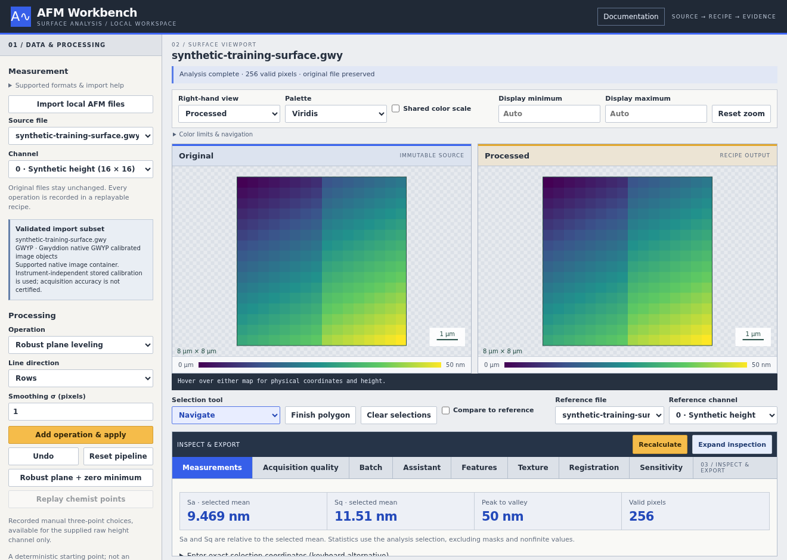
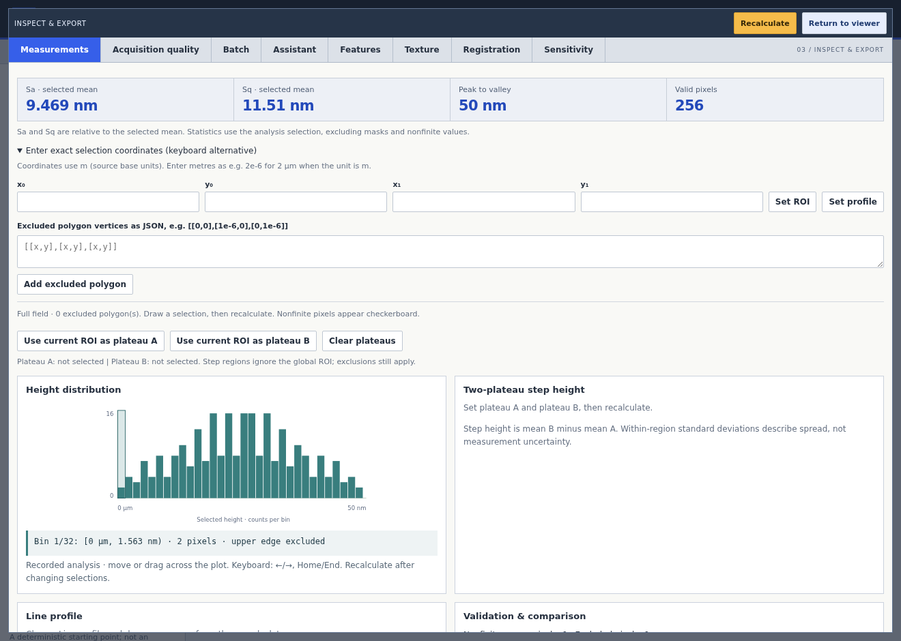

# Using the AFM workspace

Open **Documentation** in the main toolbar for the [in-app guide](../web/help.html) and complete pilot SOPs without a model connection. This repository guide follows the same workspace controls.

## General

Start with **Import local files**, then select a source and channel. Read **Import support**, warnings and channel metadata before measuring. The [capability and evidence matrix](../web/capabilities.html) and [supported-input matrix](supported-inputs.md) describes specific image subsets, not blanket instrument compatibility. Check lateral and vertical units; unknown units remain unknown, and an electrical channel is not a height measurement.

Processing preserves original measurements. Choose an **Operation**, then **Add operation & apply**; review History, **Undo**, or **Reset pipeline**. Select an ROI, line profile or exclusion polygon with **Selection tool**. In **Measurements**, **Enter exact selection coordinates** provides a keyboard alternative in source base units. Use **Recalculate** in the inspection toolbar after selection edits; it remains available in expanded inspection. Imported masks and nonfinite pixels are excluded from measurements.

_Import and channel selection in a synthetic training example, not an experimental result._

Use Left/Right and Home/End to navigate inspection tabs. **Expand inspection** opens a larger modal; Escape returns to the viewer. On narrow screens, **Data & processing** reveals source and pipeline controls.

**Save PNG** above each surface map downloads its current viewport, including the selected palette, selections, physical scale bar and color legend. The right-hand button follows Processed, Reference or Processed − reference. Recalculate after changing the analysis before exporting. PNG is a display image at the current viewport resolution; it does not replace numerical arrays or the saved recipe.

**Save recipe** retains the legacy format; **Save portable recipe** verifies a captured analysis and adds reorder-safe checksums. **Load recipe** accepts either format and requires the matching inputs and code for strict replay. **Export analysis TAR** contains results and provenance, not the original measurement bytes. Keep the raw files separately and download work before reloading: imports and unfinished work are session-only. See [recipe guidance](recipe-interchange.md).

### Inspect plotted values

Move or drag across **Height distribution** to see bin bounds and pixel counts, including empty bins. Move across **Line profile** to read the nearest recorded sample's distance, height, and source X/Y coordinates. Missing/excluded heights remain unavailable. Focus either plot and use Left/Right, Home/End for keyboard navigation. Readouts describe the last completed analysis; changing selections requires **Recalculate**. Cursor inspection does not alter recipes or measurements.

## Agents and automation

Configure the shared connection under **Ask for a plan** in **Assistant**: choose a [provider preset or custom endpoint](provider-compatibility.md), enter an explicit model ID and, when required, a session-only API key. The host must permit the provider origin and the provider must permit browser CORS. Presets do not certify a live connection; credentials are excluded from audit downloads.

- **Help agent** answers interface questions and links to guide topics and controls. It can work without a measurement and cannot execute analysis. Its requests contain your question and curated help, not measurement data. [Help details](help-agent.md).
- **Reviewed planning:** refresh/inspect sources, explicitly select permitted channels, and optionally select verified compact evidence. Review a proposed plan's exact arguments, validate, then explicitly run. Proposals do not execute automatically. Plans operate independently of the viewer pipeline. [Planning and context](model-provider.md).
- **Autonomous analysis:** enter a goal and scientific constraints, select channels and round/tool limits, then **Start goal** to authorize iterative local execution within those bounds. **Pause** waits after a running tool; **Resume** continues; **Stop** cancels a provider request and prevents later calls. A running numerical operation finishes and stays recorded. [Autonomous controls and limits](autonomous-agent.md).

Optional [pilot SOPs](workflow-sops.md) guide a goal. Read the chosen version and supply required choices and deviations; these are retained in the goal audit. Use **Expected SOP settings** to record approved processing and selection before execution, then **Check SOP records** to inspect missing or matching baseline, processing, diagnostic and replay evidence. SOP selection and record completeness are not scientific conformance certificates. Download goal/help/conversation audits, plan runs, the tool journal and result artifacts before reload or replacement. [Verified evidence reports](evidence-reports.md) retain source and artifact identities; model-selected evidence is not a new measurement or proof that a goal is scientifically achieved.

## Common workflows

### Relative feature or step height

1. Select a calibrated height channel and inspect the feature. If leveling is needed, justify and record it first; retain an original-values baseline.
2. Draw a line profile across the reference surface and feature, then **Recalculate**. Use the profile to inspect shape and choose representative flat regions; a peak in the profile is not the two-plateau measurement.
3. Draw a rectangular ROI on the reference surface. Select **Use current ROI as plateau A**.
4. Draw a non-overlapping ROI on the feature's plateau. Select **Use current ROI as plateau B**, then **Recalculate**.
5. Read **Two-plateau step height**: **mean B minus mean A**, in the stored vertical unit. Review both means, standard deviations and valid pixel counts. Plateau rectangles are independent of the global ROI; imported masks, nonfinite values and exclusion polygons still apply. Within-region spread is not measurement uncertainty. Save the recipe and results.

_ROI, profile and plateau controls on synthetic training data, not an experimental result._

For connected regions rather than two plateaus, open **Features**, capture processed analysis and review an explicit threshold before segmentation. Its excursion is relative to that threshold, not automatically relative to the surrounding substrate. Region area is projected pixel area; labels do not establish particle or defect identity. See [feature workflow](segmentation-workflows.md) and [measurement definitions](segmentation.md).

### Roughness with original and processed results

1. Select the source/channel and record units, masks and analysis selection. Measure original values and save that baseline.
2. Choose appropriate leveling explicitly; review its parameters and apply it. Keep the selection comparable, or record why it changed.
3. Review processed Sa/Sq, range, selected area and valid/excluded counts. Sa/Sq are relative to the selected mean; processing and selection can change them.
4. Use **Check acquisition** for diagnostics on the original channel. Review candidates in context rather than treating them as defects. Save both analyses and strictly replay the processed recipe. The [roughness pilot SOP](workflow-sops.md) and [quality guide](quality.md) describe these checks.

### Spatial texture: PSD and autocorrelation

1. Finish processing and **Recalculate**. Choose a valid rectangular domain at least 2 × 2 pixels; internal masked/nonfinite pixels or polygon holes cause rejection rather than silent filling.
2. In **Texture**, review **Capture domain**, then select **Capture processed analysis**. Current viewer selection retains its completed recipe and ROI. Full processed image removes the ROI and reruns the same operations in a separate capture; ROI-dependent leveling can change. Crops, masks and exclusion polygons remain. The viewer baseline stays unchanged. Later viewer edits do not change either capture; explicitly recapture to use another surface.
3. Choose **Detrend** (None, Subtract mean, or Subtract plane) and **PSD window** (Boxcar or Periodic Hann), then **Measure captured texture**. These preprocessing choices are additional to the captured pipeline and are recorded.
4. Review the domain preview: dashed amber shows the requested area before measurement; solid amber shows the exact effective rectangle afterward. Its dimensions and physical/half-open processed-pixel bounds match the exported report. Invalid outer rows/columns can trim the domain; internal holes reject. Small ROIs limit long-wavelength coverage. Inspect PSD frequency axes, ACF lag axes, directional cuts, units, warnings, PSD integral versus expected mean square, and zero-lag ACF. Display bins/cuts average recorded bins; the log option changes only the PSD display. Normalized ACF is unavailable for zero-energy data. Edge lags have fewer overlapping pairs; leveling and finite image area affect interpretation.
5. Download texture JSON for the report and **Download full numerical TAR** for full arrays and replay provenance. Changing texture settings requires another measurement. See [texture exports](texture-workflows.md) and [estimator definitions](texture.md); no automatic correlation-length or material identification is claimed.

For other tasks, follow [batch processing](browser-batch.md), [translation registration](registration-workflows.md), or [analysis sensitivity](sensitivity-workflows.md). Sensitivity alternatives describe dependence on processing choices, not independent samples or confidence intervals.

## Three-point leveling

Open **Data & processing → Three-point leveling** after recalculating the intended source, pipeline and selection. Start a fresh draft, click three points, and drag numbered markers or enter exact physical coordinates. The point selector lets you replace any point. Sampling radius is in pixels; the visible disk includes positions excluded by masks or the ROI, which the numerical engine omits.

**Preview plane** changes only the preview map. The measurements remain those of the committed recipe, and analysis saving/capture is disabled until the preview is canceled or applied. **Apply previewed plane** appends exactly one `three_point` operation; zero-minimum shifting remains an explicit separate choice. Coordinate/radius edits invalidate the preview. Source, channel, selection or pipeline changes discard the active draft.

Saved/replayed recipes and history branches restore recorded markers using geometry from before their operation, including crop offsets and non-square pixels. Recorded points are read-only; start a new draft to choose another plane. Out-of-image, collinear, or unusable masked/ROI samples reject; a successful fit does not establish that the chosen points represent the sample background.

Validation uses generated surfaces in `tests/browser-three-point.mjs`, including exact direct-engine agreement, crop/offset geometry, pointer/keyboard editing, cancel/replay and invalid-sample checks. Private laboratory reference regressions are kept outside the public repository.

## Line slopes and curvature

Save a baseline, then choose **Line polynomial correction**, direction and degree (0–3). The operation fits only selected valid background pixels, excluding masks and polygons, then subtracts across every finite pixel of each fitted line. Empty fit lines remain unchanged and are reported. A partly selected line with too few pixels rejects the entire operation. Inspect per-line fit records, compare measurements and use Undo when the choice removes real structure. Minimum-zero shifting remains separate. See [definitions, validation and replay compatibility](line-polynomial.md).
